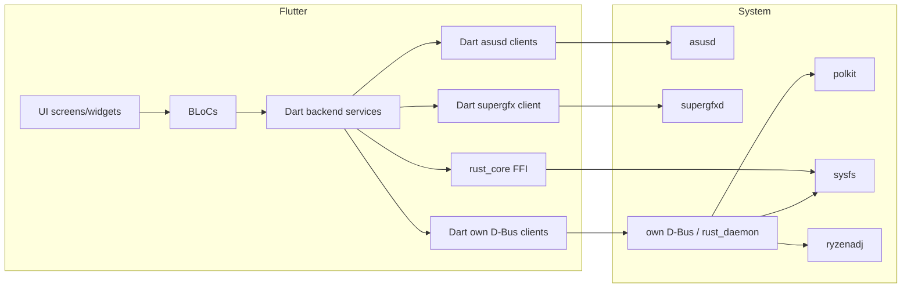

# App Function Interaction Scheme

Этот документ описывает, через какие слои проходят функции приложения: от UI до системного backend. Формат маршрутов:

`ui -> bloc -> backend service -> client/backend -> system component`

## Legend

| Layer | Meaning |
| --- | --- |
| `ui` | Flutter screen/widget. |
| `bloc` | Flutter BLoC state machine. |
| `backend service` | Dart service interface/implementation. |
| `asusd` | `xyz.ljones.Asusd` D-Bus service. |
| `supergfxd` | `org.supergfxctl.Daemon` D-Bus service. |
| `own dbus / rust_daemon` | `com.asuslinuxcontrol.Daemon` D-Bus interface implemented by the privileged Rust daemon. |
| `rust_core ffi` | Flutter Rust Bridge calls into `rust_core`. |
| `sysfs` | Linux kernel/device files under `/sys`. |
| `ryzenadj` | External CLI used for Ryzen temperature limit. |

## High-Level Scheme

## Current Functions

| Function | Route | Files | System owner | Persistence |
| --- | --- | --- | --- | --- |
| Load performance mode | `ui -> PerformanceBloc -> BridgeService -> AsusdClient -> asusd` | `lib/screens/home_screen.dart`, `lib/blocs/performance/*`, `lib/services/bridge_service.dart`, `lib/services/dbus_client.dart` | asusd `PlatformProfile` | asusd/profile |
| Set performance mode | `ui -> PerformanceBloc -> BridgeService -> AsusdClient -> asusd` | `lib/screens/home_screen.dart`, `lib/widgets/mode_selector.dart`, `lib/blocs/performance/*`, `lib/services/bridge_service.dart`, `lib/services/dbus_client.dart` | asusd `PlatformProfile` | asusd/profile |
| Check battery charge limit support | `ui -> BatteryBloc -> BridgeService -> AsusdClient -> asusd` | `lib/screens/battery_screen.dart`, `lib/blocs/battery/*`, `lib/services/bridge_service.dart`, `lib/services/dbus_client.dart` | asusd `ChargeControlEndThreshold` | none |
| Load battery charge limit/status | `ui -> BatteryBloc -> BridgeService -> AsusdClient -> asusd` | `lib/screens/battery_screen.dart`, `lib/blocs/battery/*`, `lib/services/battery_service.dart`, `lib/services/bridge_service.dart`, `lib/services/dbus_client.dart` | asusd `ChargeControlEndThreshold` | asusd/platform |
| Set battery charge limit | `ui -> BatteryBloc -> BridgeService -> AsusdClient -> asusd` | `lib/screens/battery_screen.dart`, `lib/blocs/battery/*`, `lib/services/bridge_service.dart`, `lib/services/dbus_client.dart` | asusd `ChargeControlEndThreshold` | asusd/platform |
| Load TDP config | `ui -> TdpBloc -> BridgeService -> AsusdClient + DbusClient -> asusd + own dbus / rust_daemon` | `lib/screens/tdp_screen.dart`, `lib/blocs/tdp/*`, `lib/services/tdp_service.dart`, `lib/services/bridge_service.dart`, `lib/services/dbus_client.dart` | asusd for PL1/SPPT; own daemon for temp limit state | asusd/profile + `/var/lib/asus-linux-control/temp-limit.json` |
| Set TDP power limits | `ui -> TdpBloc -> BridgeService -> AsusdClient -> asusd` | `lib/screens/tdp_screen.dart`, `lib/widgets/tdp/*`, `lib/blocs/tdp/*`, `lib/services/bridge_service.dart`, `lib/services/dbus_client.dart` | asusd Armoury PPT objects | asusd/profile |
| Clear TDP power limits | `ui -> TdpBloc -> BridgeService -> AsusdClient -> asusd` | `lib/screens/tdp_screen.dart`, `lib/blocs/tdp/*`, `lib/services/bridge_service.dart`, `lib/services/dbus_client.dart` | asusd `RestoreDefault` + `EnablePptGroup=false` | asusd/profile |
| Set CPU temperature limit | `ui -> TdpBloc -> BridgeService -> DbusClient -> own dbus / rust_daemon -> ryzenadj` | `lib/screens/tdp_screen.dart`, `lib/widgets/tdp/*`, `lib/blocs/tdp/*`, `lib/services/bridge_service.dart`, `lib/services/dbus_client.dart`, `rust_daemon/src/main.rs`, `rust_daemon/src/hardware/temp.rs` | own daemon with polkit | `/var/lib/asus-linux-control/temp-limit.json` |
| Apply saved CPU temperature limit on daemon startup | `systemd -> rust_daemon -> ryzenadj` | `install/dbus/com.asuslinuxcontrol.Daemon.service`, `rust_daemon/src/main.rs`, `rust_daemon/src/hardware/temp.rs` | own daemon | reads `/var/lib/asus-linux-control/temp-limit.json` |
| Load fan capabilities | `ui -> FanBloc -> FanServiceImpl -> rust_core ffi -> sysfs` | `lib/screens/fan_screen.dart`, `lib/blocs/fan/*`, `lib/services/fan/*`, `rust_core/src/api.rs`, `rust_core/src/services/fan.rs` | `rust_core` direct sysfs reads | none |
| Load fan RPMs | `ui -> FanBloc -> FanServiceImpl -> rust_core ffi -> sysfs` | `lib/screens/fan_screen.dart`, `lib/blocs/fan/*`, `lib/services/fan/*`, `rust_core/src/api.rs`, `rust_core/src/services/fan.rs` | `rust_core` direct sysfs reads | none |
| Load CPU/GPU fan temperatures | `ui -> FanBloc -> FanServiceImpl -> rust_core ffi -> sysfs` | `lib/screens/fan_screen.dart`, `lib/blocs/fan/*`, `lib/services/fan/fan_service_impl.dart`, `rust_core/src/api.rs`, `rust_core/src/services/temp.rs` | `rust_core` direct sysfs reads | none |
| Load asusd fan curves | `ui -> FanBloc -> FanServiceImpl -> AsusdFanClient -> asusd` | `lib/screens/fan_screen.dart`, `lib/blocs/fan/*`, `lib/services/fan/*`, `lib/services/asusd_fan_client.dart` | asusd `FanCurves` | asusd/profile |
| Set asusd fan curve | `ui -> FanBloc -> FanServiceImpl -> AsusdFanClient -> asusd` | `lib/screens/fan_screen.dart`, `lib/widgets/fan/fan_curve_editor.dart`, `lib/blocs/fan/*`, `lib/services/fan/*`, `lib/services/asusd_fan_client.dart` | asusd `FanCurves` | asusd/profile |
| Set constant fan speed | `ui -> FanBloc -> FanServiceImpl -> AsusdFanClient -> asusd` | `lib/screens/fan_screen.dart`, `lib/blocs/fan/*`, `lib/services/fan/*`, `lib/services/asusd_fan_client.dart` | asusd flat fan curve | asusd/profile |
| Reset fan curves to defaults | `ui -> FanBloc -> FanServiceImpl -> AsusdFanClient -> asusd` | `lib/screens/fan_screen.dart`, `lib/blocs/fan/*`, `lib/services/fan/*`, `lib/services/asusd_fan_client.dart` | asusd `SetCurvesToDefaults` | asusd/profile |
| Start dynamic fan engine | `ui -> FanBloc -> FanServiceImpl -> FanEngineDaemonClient -> own dbus / rust_daemon -> sysfs` | `lib/screens/fan_screen.dart`, `lib/blocs/fan/*`, `lib/services/fan/*`, `rust_daemon/src/main.rs`, `rust_daemon/src/fan_engine/*` | own daemon with polkit | `rust_daemon` runtime memory; lost on daemon restart, separate from Flutter app state |
| Stop dynamic fan engine | `ui -> FanBloc -> FanServiceImpl -> FanEngineDaemonClient -> own dbus / rust_daemon -> sysfs` | `lib/screens/fan_screen.dart`, `lib/blocs/fan/*`, `lib/services/fan/*`, `rust_daemon/src/main.rs`, `rust_daemon/src/fan_engine/*` | own daemon with polkit | `rust_daemon` runtime memory cleared; auto mode restored |
| Update dynamic fan curve | `ui -> FanBloc -> FanServiceImpl -> FanEngineDaemonClient -> own dbus / rust_daemon -> sysfs` | `lib/screens/fan_screen.dart`, `lib/widgets/fan/fan_curve_editor.dart`, `lib/blocs/fan/*`, `lib/services/fan/*`, `rust_daemon/src/main.rs`, `rust_daemon/src/fan_engine/*` | own daemon with polkit | `rust_daemon` runtime memory; not persisted to disk |
| Read dynamic fan engine state | `ui -> FanBloc -> FanServiceImpl -> FanEngineDaemonClient -> own dbus / rust_daemon` | `lib/screens/fan_screen.dart`, `lib/blocs/fan/*`, `lib/services/fan/*`, `rust_daemon/src/main.rs` | own daemon | `rust_daemon` runtime memory; unavailable after daemon restart |
| Run fan max speed test | `ui -> FanBloc -> FanServiceImpl -> AsusdFanClient + rust_core ffi -> asusd + sysfs` | `lib/screens/fan_screen.dart`, `lib/blocs/fan/*`, `lib/services/fan/fan_service_impl.dart`, `lib/services/asusd_fan_client.dart` | asusd applies temporary flat curve; `rust_core` reads RPM | previous curve restored after test |
| Load GPU capabilities | `ui -> GpuBloc -> SupergfxGpuService -> SupergfxClient -> supergfxd` | `lib/screens/gpu_screen.dart`, `lib/blocs/gpu/*`, `lib/services/gpu_service.dart`, `lib/services/supergfx_client.dart` | supergfxd | none |
| Load GPU status | `ui -> GpuBloc -> SupergfxGpuService -> SupergfxClient -> supergfxd` | `lib/screens/gpu_screen.dart`, `lib/blocs/gpu/*`, `lib/services/gpu_service.dart`, `lib/services/supergfx_client.dart` | supergfxd | none |
| Set GPU mode | `ui -> GpuBloc -> SupergfxGpuService -> SupergfxClient -> supergfxd` | `lib/screens/gpu_screen.dart`, `lib/widgets/gpu/*`, `lib/blocs/gpu/*`, `lib/services/gpu_service.dart`, `lib/services/supergfx_client.dart` | supergfxd | supergfxd/system state; may require logout/reboot |
| Watch GPU mode changes | `ui/service subscriber -> SupergfxClient -> supergfxd signal` | `lib/services/supergfx_client.dart` | supergfxd `NotifyGfx` signal | none |
| Input diagnostics | `ui -> InputDiagnostics widget -> debugPrint/test sink` | `lib/widgets/input_diagnostics.dart` | Flutter runtime | none |
| Copyable errors/info | `ui/bloc listener -> CopyableAlert -> Flutter dialog/snackbar` | `lib/widgets/copyable_alert.dart` | Flutter runtime | none |
| Backend operation tracing | `service/client -> BackendLogger -> debugPrint` | `lib/services/backend_logger.dart` | Flutter runtime | none |

## Planned Functions

| Function | Route | Files planned | System owner | Persistence |
| --- | --- | --- | --- | --- |
| Load Ryzen boost mode/status | `ui -> CpuBoostBloc -> BridgeService -> CpuBoostDaemonClient -> own dbus / rust_daemon -> cpufreq sysfs` | `lib/blocs/cpu_boost/*`, `lib/services/cpu_boost_service.dart`, `lib/services/cpu_boost_daemon_client.dart`, `rust_daemon/src/hardware/cpu_boost.rs` | own daemon reads Linux CPUFreq/amd-pstate state | `/var/lib/asus-linux-control/cpu-boost-mode.json` if saved |
| Set Ryzen boost mode | `ui -> CpuBoostBloc -> BridgeService -> CpuBoostDaemonClient -> own dbus / rust_daemon -> cpufreq sysfs` | `lib/widgets/cpu_boost/boost_mode_selector.dart`, `lib/blocs/cpu_boost/*`, `lib/services/cpu_boost_*`, `rust_daemon/src/hardware/cpu_boost.rs` | own daemon with polkit | `/var/lib/asus-linux-control/cpu-boost-mode.json` |
| Disable Ryzen boost completely | `ui -> CpuBoostBloc -> BridgeService -> CpuBoostDaemonClient -> own dbus / rust_daemon -> /sys/devices/system/cpu/cpufreq/boost=0` | same as Ryzen boost mode | Linux CPUFreq/amd-pstate boost knob | saved boost preset |
| Apply saved Ryzen boost mode on daemon startup | `systemd -> rust_daemon -> cpufreq sysfs` | `rust_daemon/src/main.rs`, `rust_daemon/src/hardware/cpu_boost.rs` | own daemon | reads `/var/lib/asus-linux-control/cpu-boost-mode.json` |

## Ownership Rules

- Prefer `asusd` for ASUS platform features it already owns: platform profile, battery charge threshold, Armoury PPT values, fan curves.
- Prefer `supergfxd` for GPU mux/eGPU/VFIO mode switching.
- Use `own dbus / rust_daemon` for privileged behavior not exposed by `asusd` or `supergfxd`: dynamic fan engine, Ryzen boost sysfs writes, temp limit persistence plus `ryzenadj`.
- Use `rust_core ffi` only for read-heavy direct hardware snapshots already implemented there: sensors, fan discovery, RPMs.
- Keep UI and BLoC layers hardware-agnostic. They should call service contracts and never know D-Bus object paths, sysfs paths, or external CLI arguments.
