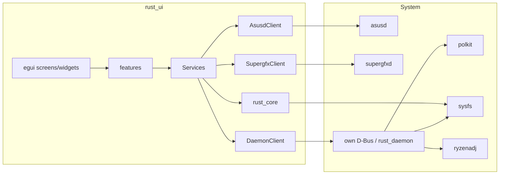

# App Function Interaction Scheme

Этот документ описывает, через какие слои проходят функции приложения: от UI до системного backend. Формат маршрутов:

`ui -> feature -> service -> client/backend -> system component`

## Legend

| Layer | Meaning |
| --- | --- |
| `ui` | egui screen/widget in `rust_ui/src/ui/`. |
| `feature` | Screen logic in `rust_ui/src/features/` (former BLoC): state + async operations. |
| `service` | Service trait implemented by `Services` in `rust_ui/src/features/services.rs`. |
| `asusd` | `xyz.ljones.Asusd` D-Bus service. |
| `supergfxd` | `org.supergfxctl.Daemon` D-Bus service. |
| `own dbus / rust_daemon` | `com.asuslinuxcontrol.Daemon` D-Bus interface implemented by the privileged Rust daemon. |
| `rust_core` | Direct calls into the `rust_core` library (linked as an rlib). |
| `sysfs` | Linux kernel/device files under `/sys`. |
| `ryzenadj` | External CLI used for Ryzen temperature limit. |

## High-Level Scheme

## Current Functions

| Function | Route | Files | System owner | Persistence |
| --- | --- | --- | --- | --- |
| Load performance mode | `ui -> features::performance -> Services -> AsusdClient -> asusd` | `rust_ui/src/ui/screens/home.rs`, `rust_ui/src/features/performance.rs`, `rust_ui/src/features/services.rs`, `rust_ui/src/backend/asusd.rs` | asusd `PlatformProfile` | asusd/profile |
| Set performance mode | `ui -> features::performance -> Services -> AsusdClient -> asusd` | `rust_ui/src/ui/screens/home.rs`, `rust_ui/src/ui/widgets.rs`, `rust_ui/src/features/performance.rs`, `rust_ui/src/features/services.rs`, `rust_ui/src/backend/asusd.rs` | asusd `PlatformProfile` | asusd/profile |
| Check battery charge limit support | `ui -> features::battery -> Services -> AsusdClient -> asusd` | `rust_ui/src/ui/screens/battery.rs`, `rust_ui/src/features/battery.rs`, `rust_ui/src/features/services.rs`, `rust_ui/src/backend/asusd.rs` | asusd `ChargeControlEndThreshold` | none |
| Load battery charge limit/status | `ui -> features::battery -> Services -> AsusdClient -> asusd` | `rust_ui/src/ui/screens/battery.rs`, `rust_ui/src/features/battery.rs`, `rust_ui/src/features/services.rs`, `rust_ui/src/backend/asusd.rs` | asusd `ChargeControlEndThreshold` | asusd/platform |
| Set battery charge limit | `ui -> features::battery -> Services -> AsusdClient -> asusd` | `rust_ui/src/ui/screens/battery.rs`, `rust_ui/src/features/battery.rs`, `rust_ui/src/features/services.rs`, `rust_ui/src/backend/asusd.rs` | asusd `ChargeControlEndThreshold` | asusd/platform |
| Load TDP config | `ui -> features::tdp -> Services -> AsusdClient + DaemonClient -> asusd + own dbus / rust_daemon` | `rust_ui/src/ui/screens/tdp.rs`, `rust_ui/src/features/tdp.rs`, `rust_ui/src/features/services.rs`, `rust_ui/src/backend/asusd.rs`, `rust_ui/src/backend/daemon.rs` | asusd for PL1/SPPT; own daemon for temp limit state | asusd/profile + `/var/lib/asus-linux-control/temp-limit.json` |
| Set TDP power limits | `ui -> features::tdp -> Services -> AsusdClient -> asusd` | `rust_ui/src/ui/screens/tdp.rs`, `rust_ui/src/ui/widgets.rs`, `rust_ui/src/features/tdp.rs`, `rust_ui/src/features/services.rs`, `rust_ui/src/backend/asusd.rs` | asusd Armoury PPT objects | asusd/profile |
| Clear TDP power limits | `ui -> features::tdp -> Services -> AsusdClient -> asusd` | `rust_ui/src/ui/screens/tdp.rs`, `rust_ui/src/features/tdp.rs`, `rust_ui/src/features/services.rs`, `rust_ui/src/backend/asusd.rs` | asusd `RestoreDefault` + `EnablePptGroup=false` | asusd/profile |
| Set CPU temperature limit | `ui -> features::tdp -> Services -> DaemonClient -> own dbus / rust_daemon -> ryzenadj` | `rust_ui/src/ui/screens/tdp.rs`, `rust_ui/src/ui/widgets.rs`, `rust_ui/src/features/tdp.rs`, `rust_ui/src/features/services.rs`, `rust_ui/src/backend/asusd.rs`, `rust_ui/src/backend/daemon.rs`, `rust_daemon/src/main.rs`, `rust_daemon/src/hardware/temp.rs` | own daemon with polkit | `/var/lib/asus-linux-control/temp-limit.json` |
| Apply saved CPU temperature limit on daemon startup | `systemd -> rust_daemon -> ryzenadj` | `install/dbus/com.asuslinuxcontrol.Daemon.service`, `rust_daemon/src/main.rs`, `rust_daemon/src/hardware/temp.rs` | own daemon | reads `/var/lib/asus-linux-control/temp-limit.json` |
| Load fan capabilities | `ui -> features::fan -> Services -> rust_core -> sysfs` | `rust_ui/src/ui/screens/fan.rs`, `rust_ui/src/features/fan/*`, `rust_ui/src/features/services.rs`, `rust_core/src/api.rs`, `rust_core/src/services/fan.rs` | `rust_core` direct sysfs reads | none |
| Load fan RPMs | `ui -> features::fan -> Services -> rust_core -> sysfs` | `rust_ui/src/ui/screens/fan.rs`, `rust_ui/src/features/fan/*`, `rust_ui/src/features/services.rs`, `rust_core/src/api.rs`, `rust_core/src/services/fan.rs` | `rust_core` direct sysfs reads | none |
| Load CPU/GPU fan temperatures | `ui -> features::fan -> Services -> rust_core -> sysfs` | `rust_ui/src/ui/screens/fan.rs`, `rust_ui/src/features/fan/*`, `rust_ui/src/features/services.rs`, `rust_core/src/api.rs`, `rust_core/src/services/temp.rs` | `rust_core` direct sysfs reads | none |
| Load asusd fan curves | `ui -> features::fan -> Services -> AsusdClient -> asusd` | `rust_ui/src/ui/screens/fan.rs`, `rust_ui/src/features/fan/*`, `rust_ui/src/features/services.rs`, `rust_ui/src/backend/asusd.rs` | asusd `FanCurves` | asusd/profile |
| Set asusd fan curve | `ui -> features::fan -> Services -> AsusdClient -> asusd` | `rust_ui/src/ui/screens/fan.rs`, `rust_ui/src/ui/curve_editor.rs`, `rust_ui/src/features/fan/*`, `rust_ui/src/features/services.rs`, `rust_ui/src/backend/asusd.rs` | asusd `FanCurves` | asusd/profile |
| Set constant fan speed | `ui -> features::fan -> Services -> AsusdClient -> asusd` | `rust_ui/src/ui/screens/fan.rs`, `rust_ui/src/features/fan/*`, `rust_ui/src/features/services.rs`, `rust_ui/src/backend/asusd.rs` | asusd flat fan curve | asusd/profile |
| Reset fan curves to defaults | `ui -> features::fan -> Services -> AsusdClient -> asusd` | `rust_ui/src/ui/screens/fan.rs`, `rust_ui/src/features/fan/*`, `rust_ui/src/features/services.rs`, `rust_ui/src/backend/asusd.rs` | asusd `SetCurvesToDefaults` | asusd/profile |
| Start dynamic fan engine | `ui -> features::fan -> Services -> DaemonClient -> own dbus / rust_daemon -> sysfs` | `rust_ui/src/ui/screens/fan.rs`, `rust_ui/src/features/fan/*`, `rust_ui/src/features/services.rs`, `rust_ui/src/backend/daemon.rs`, `rust_daemon/src/main.rs`, `rust_daemon/src/fan_engine/*` | own daemon with polkit | `rust_daemon` runtime memory; lost on daemon restart, separate from UI settings |
| Stop dynamic fan engine | `ui -> features::fan -> Services -> DaemonClient -> own dbus / rust_daemon -> sysfs` | `rust_ui/src/ui/screens/fan.rs`, `rust_ui/src/features/fan/*`, `rust_ui/src/features/services.rs`, `rust_ui/src/backend/daemon.rs`, `rust_daemon/src/main.rs`, `rust_daemon/src/fan_engine/*` | own daemon with polkit | `rust_daemon` runtime memory cleared; auto mode restored |
| Update dynamic fan curve | `ui -> features::fan -> Services -> DaemonClient -> own dbus / rust_daemon -> sysfs` | `rust_ui/src/ui/screens/fan.rs`, `rust_ui/src/ui/curve_editor.rs`, `rust_ui/src/features/fan/*`, `rust_ui/src/features/services.rs`, `rust_ui/src/backend/daemon.rs`, `rust_daemon/src/main.rs`, `rust_daemon/src/fan_engine/*` | own daemon with polkit | `rust_daemon` runtime memory; not persisted to disk |
| Read dynamic fan engine state | `ui -> features::fan -> Services -> DaemonClient -> own dbus / rust_daemon` | `rust_ui/src/ui/screens/fan.rs`, `rust_ui/src/features/fan/*`, `rust_ui/src/features/services.rs`, `rust_ui/src/backend/daemon.rs`, `rust_daemon/src/main.rs` | own daemon | `rust_daemon` runtime memory; unavailable after daemon restart |
| Run fan max speed test | `ui -> features::fan -> Services -> AsusdClient + rust_core -> asusd + sysfs` | `rust_ui/src/ui/screens/fan.rs`, `rust_ui/src/features/fan/*`, `rust_ui/src/features/services.rs`, `rust_ui/src/backend/asusd.rs` | asusd applies temporary flat curve; `rust_core` reads RPM | previous curve restored after test |
| Load GPU capabilities | `ui -> features::gpu -> Services -> SupergfxClient -> supergfxd` | `rust_ui/src/ui/screens/gpu.rs`, `rust_ui/src/features/gpu.rs`, `rust_ui/src/backend/supergfx.rs` | supergfxd | none |
| Load GPU status | `ui -> features::gpu -> Services -> SupergfxClient -> supergfxd` | `rust_ui/src/ui/screens/gpu.rs`, `rust_ui/src/features/gpu.rs`, `rust_ui/src/backend/supergfx.rs` | supergfxd | none |
| Set GPU mode | `ui -> features::gpu -> Services -> SupergfxClient -> supergfxd` | `rust_ui/src/ui/screens/gpu.rs`, `rust_ui/src/features/gpu.rs`, `rust_ui/src/backend/supergfx.rs` | supergfxd | supergfxd/system state; may require logout/reboot |
| Gamepad navigation | `rust_core steam_input poller -> InputBridge -> egui focus / curve editor` | `rust_ui/src/input.rs`, `rust_core/src/services/steam_input.rs` | UI process | none |
| Copyable errors/info | `ui -> Alert -> egui modal` | `rust_ui/src/ui/alert.rs` | UI process | none |
| Backend operation tracing | `client -> logging::trace -> log (RUST_LOG)` | `rust_ui/src/logging.rs` | UI process | none |
| Single instance / raise window | `second launch -> unix socket -> primary instance -> ViewportCommand::Focus` | `rust_ui/src/single_instance.rs`, `rust_ui/src/main.rs` | UI process | `$XDG_RUNTIME_DIR/asus-linux-control.sock` |

## Planned Functions

| Function | Route | Files planned | System owner | Persistence |
| --- | --- | --- | --- | --- |
| Load Ryzen boost mode/status | `ui -> features::cpu_boost -> Services -> DaemonClient -> own dbus / rust_daemon -> cpufreq sysfs` | `rust_ui/src/features/cpu_boost.rs`, `rust_ui/src/backend/daemon.rs`, `rust_daemon/src/hardware/cpu_boost.rs` | own daemon reads Linux CPUFreq/amd-pstate state | `/var/lib/asus-linux-control/cpu-boost-mode.json` if saved |
| Set Ryzen boost mode | `ui -> features::cpu_boost -> Services -> DaemonClient -> own dbus / rust_daemon -> cpufreq sysfs` | `rust_ui/src/features/cpu_boost.rs`, `rust_ui/src/backend/daemon.rs`, `rust_daemon/src/hardware/cpu_boost.rs` | own daemon with polkit | `/var/lib/asus-linux-control/cpu-boost-mode.json` |
| Disable Ryzen boost completely | `ui -> features::cpu_boost -> Services -> DaemonClient -> own dbus / rust_daemon -> /sys/devices/system/cpu/cpufreq/boost=0` | same as Ryzen boost mode | Linux CPUFreq/amd-pstate boost knob | saved boost preset |
| Apply saved Ryzen boost mode on daemon startup | `systemd -> rust_daemon -> cpufreq sysfs` | `rust_daemon/src/main.rs`, `rust_daemon/src/hardware/cpu_boost.rs` | own daemon | reads `/var/lib/asus-linux-control/cpu-boost-mode.json` |

## Ownership Rules

- Prefer `asusd` for ASUS platform features it already owns: platform profile, battery charge threshold, Armoury PPT values, fan curves.
- Prefer `supergfxd` for GPU mux/eGPU/VFIO mode switching.
- Use `own dbus / rust_daemon` for privileged behavior not exposed by `asusd` or `supergfxd`: dynamic fan engine, Ryzen boost sysfs writes, temp limit persistence plus `ryzenadj`.
- Use `rust_core` only for read-heavy direct hardware snapshots already implemented there: sensors, fan discovery, RPMs.
- Keep `ui` and `features` hardware-agnostic. They should call service traits and never know D-Bus object paths, sysfs paths, or external CLI arguments.
