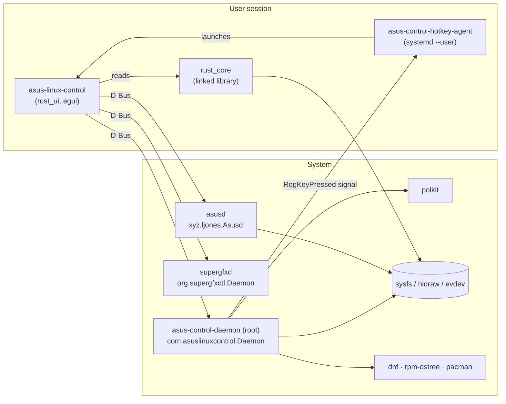

# Architecture

ASUS Linux Control is split into an unprivileged desktop app and a small privileged daemon.
Everything that needs root goes through D-Bus and is authorised by Polkit; the UI never writes
to sysfs itself.



## Processes

| Process | Runs as | Started by | Role |
|---|---|---|---|
| `asus-linux-control` | user | menu entry, ROG key, terminal | egui desktop app; single instance |
| `asus-control-daemon` | root | systemd (`multi-user.target`) or D-Bus activation | privileged writes not covered by asusd/supergfxd |
| `asus-control-hotkey-agent` | user | `systemd --user` (`graphical-session.target`) | launches / raises the app when the ROG key is pressed |
| `asusd`, `supergfxd` | root | external projects | ASUS platform features and GPU mode switching |

## Crates

| Crate | Output | Purpose |
|---|---|---|
| [`rust_ui`](modules/rust-ui.md) | binary `asus-linux-control` | Screens, screen logic behind service traits, D-Bus clients, settings |
| [`rust_core`](modules/rust-core.md) | library (linked into `rust_ui`) | Read-only hardware snapshots: fans, temperatures, CPU, GPUs, Steam Input |
| [`rust_daemon`](modules/rust-daemon.md) | binaries `asus-control-daemon`, `asus-control-hotkey-agent` | Privileged D-Bus service and the user-session hotkey agent |

There is no FFI layer: `rust_ui` links `rust_core` as an ordinary Rust dependency.

## Ownership rules

Each hardware setting has exactly one owner; the app never bypasses it.

| Owner | Settings |
|---|---|
| **asusd** | platform profile, battery charge limit, PPT power limits, fan curves |
| **supergfxd** | GPU mode (Integrated / Hybrid / Ultimate / eGPU / VFIO) |
| **own daemon** | CPU temperature ceiling (`ryzenadj`), CPU boost / EPP, dynamic fan engine, ROG key, package updates |
| **rust_core** | read-only sensors: fan RPM, temperatures, CPU clock and model, GPU list/temperature/clock |

`ui` and `features` code stays hardware-agnostic: it calls service traits and never knows
D-Bus object paths, sysfs paths or CLI arguments. Those live in `rust_ui/src/backend/`,
`rust_core` and `rust_daemon`.

## Request flow inside the UI

```text
ui/screens/*  ──►  features/*  ──►  Services (features/services.rs)  ──►  backend/* (zbus)  ──►  D-Bus
   egui              state +            trait implementations              asusd, supergfxd,
   widgets           async ops          over backend + rust_core           own daemon
```

The UI thread never blocks: a screen spawns a job on the background Tokio runtime
(`runtime.rs`), keeps the returned `Task` and polls it every frame. A finished job wakes the
UI with `request_repaint`. Errors are shown through the alert queue (`ui/alert.rs`).

## Persistence

| Data | Location | Written by |
|---|---|---|
| UI settings | `$XDG_CONFIG_HOME/asus-linux-control/settings.json` | UI |
| Hardware profiles | `$XDG_CONFIG_HOME/asus-linux-control/profiles/*.json` | UI |
| XG Mobile diagnostic session | `$XDG_STATE_HOME/asus-linux-control/xg_mobile_fan_diagnostic.json` | UI |
| CPU temperature limit per platform profile | `/var/lib/asus-linux-control/per-mode-settings.json` | daemon |
| CPU boost mode | `/var/lib/asus-linux-control/cpu-boost-mode.json` | daemon |
| Dynamic fan engine config | `/var/lib/asus-linux-control/fan-engine-config.json` | daemon |
| Profile, PPT, fan curves, charge limit | asusd's own config | asusd |
| Single-instance socket | `$XDG_RUNTIME_DIR/asus-linux-control.sock` | UI (runtime only) |

On start the daemon re-applies the saved fan engine config, CPU boost mode and temperature
limit. It also watches asusd's `PlatformProfile` and re-applies the profile's temperature limit
after every profile write, since firmware resets it.

## Security model

- The daemon owns `com.asuslinuxcontrol.Daemon` on the **system** bus. Only root may own the
  name (`install/dbus/com.asuslinuxcontrol.Daemon.conf`).
- Every write method checks a Polkit action for the calling process
  (`install/dbus/com.asuslinuxcontrol.Daemon.policy`). The active local user is allowed
  without a password (package updates always ask for admin authentication); inactive and
  remote sessions need admin authentication.
- Read methods need no authorisation.
- Inputs are validated (ranges, 8-point curves, known mode ids) before anything is written.
- Package updates run a **fixed** backend with a **fixed** command allowlist; the UI cannot
  pass commands or package names.
- On Fedora/Bazzite an SELinux module (`install/selinux/asus_control.cil`) confines the
  daemon to `asus_control_t`.
